# Customizing ALE plots

## 1 Introduction

The [ale](https://github.com/tripartio/ale) package creates plots with
several elements to help us interpret accumulated local effects.
Sometimes, we want to focus on a particular range of values or adapt the
appearance of the plots. The
[`customize()`](https://tripartio.github.io/ale/reference/customize.md)
function lets us make these changes to one or more plots in an
`ALEPlots` object.

This article demonstrates how to select plots to customize, zoom on
their axes, and add [ggplot2](https://ggplot2.tidyverse.org) layers. You
should first read the [introductory
vignette](https://tripartio.github.io/ale/articles/ale-intro.html "Introduction to the ale package")
for an explanation of ALE and the basic functionality of the package.

The workflow is to create an `ALE` object, call
[`plot()`](https://rdrr.io/r/graphics/plot.default.html) to generate an
`ALEPlots` object, customize the plots, and then print them.
Customization changes the presentation of existing ALE results; it does
not refit the model or recalculate ALE. We will keep the original plots
so that we can compare each customization with the starting point.

## 2 Prepare the diamonds example

For our illustration, we train a random forest On the diamonds dataset.
We begin by loading the necessary libraries.

``` r

library(ale)
```


    Attaching package: 'ale'

    The following object is masked from 'package:base':

        get

``` r

# Enable parallelization of the ALE package (set to the number of threads you want)
options(ale.parallel = 2)

library(dplyr)
```


    Attaching package: 'dplyr'

    The following objects are masked from 'package:stats':

        filter, lag

    The following objects are masked from 'package:base':

        intersect, setdiff, setequal, union

``` r

library(ggplot2)

# For speed, these examples use retrieve_rds() to load pre-created objects 
# from an online repository.
# To run the code yourself, execute the code blocks directly.  
serialized_objects_site <- "https://github.com/tripartio/ale/raw/wip/download"
```

The `diamonds` dataset is included with
[ggplot2](https://ggplot2.tidyverse.org). We first remove invalid
entries and duplicates, and give the physical dimensions more
descriptive names.

``` r

diamonds <- ggplot2::diamonds |>
  filter(!(x == 0 | y == 0 | z == 0)) |>
  # https://lorentzen.ch/index.php/2021/04/16/a-curious-fact-on-the-diamonds-dataset/
  distinct(
    price, carat, cut, color, clarity,
    .keep_all = TRUE
  ) |>
  rename(
    x_length = x,
    y_width = y,
    z_depth = z,
    depth_pct = depth
  )
```

We train a random forest to predict diamond prices. The forest uses all
the predictors; we will select just three of them for the ALE
demonstration.

``` r

rf_diamonds <- ranger::ranger(
  price ~ ., diamonds,  # train for IML on full dataset
  mtry = 7,  # number of variables per tree
  min.node.size = 4,  # minimum leaf (terminal node) size
  sample.fraction = 0.465,  # fraction of rows to sample
  num.trees = 50,  # small forest for a faster demonstration
  seed = 0
)
```

Next, we create ALE data to explain this random forest. For this
demonstration, we will focus on just three predictors: `carat` (weight),
`cut` (an ordered factor describing cut quality), and `x_length` (length
in millimetres). We request their three 1D main effects and all three
pairwise 2D interactions:

``` r

# Create ALE data
# # To run the slow code yourself, uncomment and execute this code block directly.
# ale_rf_diamonds <- ALE(
#   rf_diamonds,
#   data = diamonds,
#   x_cols = ~ carat + cut + x_length +
#     carat:cut + carat:x_length + cut:x_length
# )


ale_rf_diamonds <- serialized_objects_site |> 
  file.path('ale_rf_diamonds_custom_plots.0.6.0.rds') |>
  url() |> 
  readRDS()
```

Now, we create an `ALEPlots` object to generate and manipulate ALE
plots:

``` r

# Generate an ALEPlots object and keep it as our starting point.
diamonds_plots <- ale_rf_diamonds |> 
  plot()
```

The [`print()`](https://rdrr.io/r/base/print.html) method displays 1D
and 2D plots separately. We can use
[`subset()`](https://rdrr.io/r/base/subset.html) to display just one set
at a time.

``` r

diamonds_plots |>
  subset(list(d1 = TRUE)) |>
  print(ncol = 1)
```

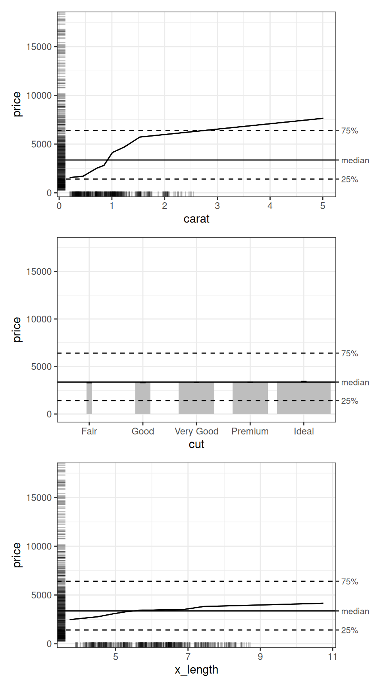

The numeric predictors have line charts, while `cut` has a column chart.
The column widths reflect the relative numbers of observations in each
level of `cut`. By default, the ALE curves are centred on the median
diamond price. Thus, the y-axis is on the price scale in US dollars,
rather than centred on zero. The horizontal lines mark the median and
the 25th and 75th percentiles of observed prices.

``` r

diamonds_plots |>
  subset(list(d2 = TRUE)) |>
  print(ncol = 1)
```

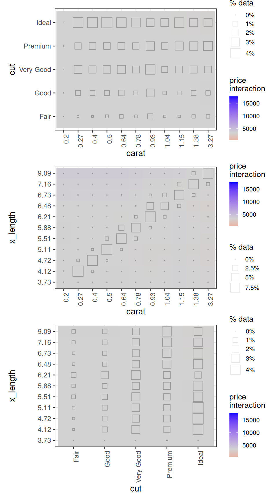

The 2D plots show interaction effects beyond the separate 1D effects.
Both axes represent predictors; the fill colour represents the
interaction effect on the price scale. The hollow squares indicate the
percentage of observations in each combination of bins. See the
[introductory
vignette](https://tripartio.github.io/ale/articles/ale-intro.html "Introduction to the ale package")
for their interpretation.

## 3 Choose which plots to customize

The `x_cols` argument of
[`customize()`](https://tripartio.github.io/ale/reference/customize.md)
selects the plots to modify. A variable name selects a 1D plot; a term
such as `"carat:cut"` selects an interaction plot. We can use
`list(d1 = TRUE)` or `list(d2 = TRUE)` to select every available plot of
one dimension, or `list(d1 = TRUE, d2 = TRUE)` to select both
dimensions.

Leaving `x_cols` unspecified applies the customization to all available
plots when the object contains only one dimension. When both 1D and 2D
plots exist, `x_cols` must be specified explicitly; it may select either
dimension or both.

Because our object contains both 1D and 2D plots, we explicitly specify
`x_cols` in each call to
[`customize()`](https://tripartio.github.io/ale/reference/customize.md).
The following example zooms the y-axis ranges of the 1D `carat` and
`cut` plots:

``` r

selected_plots <- diamonds_plots |>
  customize(
    x_cols = c("carat", "cut"),
    zoom_y = c(1000, 8000)
  )

selected_plots |>
  subset(list(d1 = TRUE)) |>
  print(ncol = 1)
```

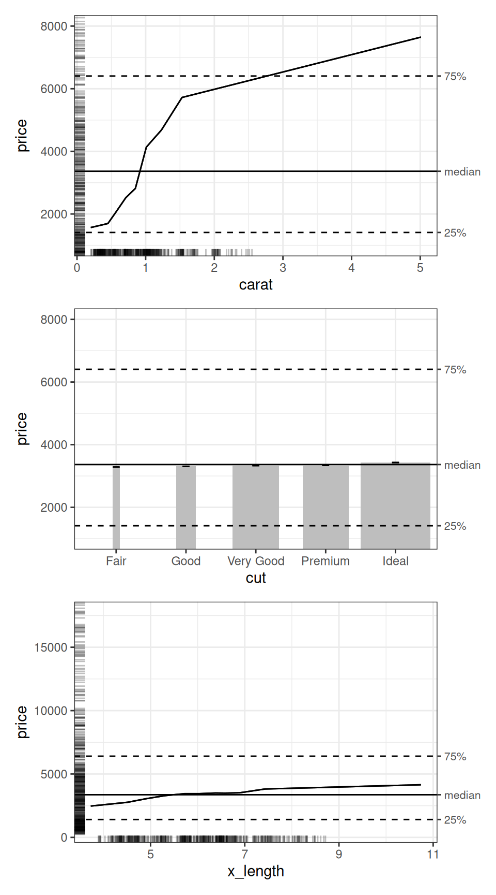

The `x_length` plot retains its original appearance. Customizing plots
with
[`customize()`](https://tripartio.github.io/ale/reference/customize.md)
does not remove the other plots from the returned object. However, we
use [`subset()`](https://rdrr.io/r/base/subset.html) to choose which
plots to display, excluding the others.

The `exclude_cols` argument excludes plots from the customization
selection. The plots remain unchanged in the `ALEPlots` object. For
example, we can apply the same zoom to every 1D plot except `cut`:

``` r

diamonds_plots |>
  customize(
    x_cols = list(d1 = TRUE),
    exclude_cols = "cut",
    zoom_y = c(1000, 8000)
  ) |> 
  subset(list(d1 = TRUE)) |> 
  print(nrow = 3)
```

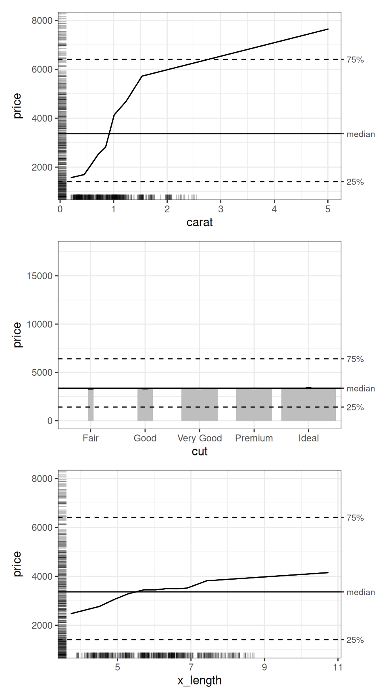

Here, the change applies to `carat` and `x_length`. All six plots are
still in `numeric_plots`. See
[`help(resolve_x_cols)`](https://tripartio.github.io/ale/reference/resolve_x_cols.md)
for more selection formats.

## 4 Focus on a predictor range with `zoom_x`

The `zoom_x` argument of
[`customize()`](https://tripartio.github.io/ale/reference/customize.md)
takes a two-element numeric vector giving the lower and upper visible
limits of the x-axis. Because our object contains both 1D and 2D plots,
we explicitly specify `x_cols` in each call to
[`customize()`](https://tripartio.github.io/ale/reference/customize.md).
The following example increases the axis text size in the 1D `carat` and
`cut` plots. The original plot is on top; the zoomed plot is below:

``` r

carat_limits <- c(0.3, 2)

x_zoomed_plots <- diamonds_plots |>
  customize(
    x_cols = "carat",
    zoom_x = carat_limits
  )

patchwork::wrap_plots(
  get(diamonds_plots, "carat"),
  get(x_zoomed_plots, "carat"),
  nrow = 2
)
```

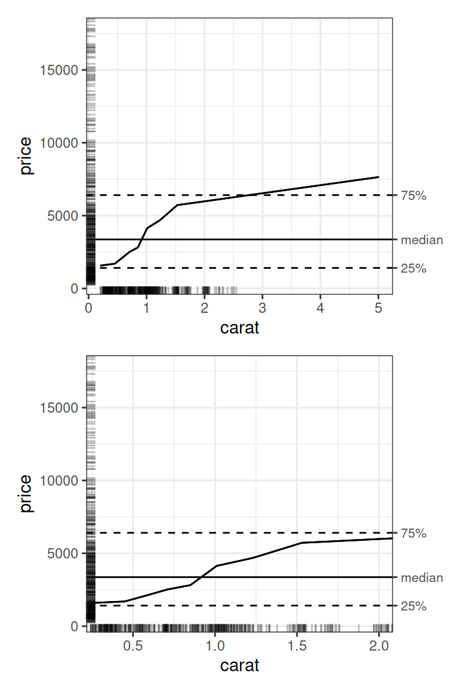

Zooming changes the viewing window, retaining the underlying plotted
data. The rug marks help us see where observations lie within the
visible range. Values outside this range are still part of the original
ALE calculation and can be plotted by respecifying
[`customize()`](https://tripartio.github.io/ale/reference/customize.md).

We apply this numeric x-axis zoom only to the 1D `carat` plot. Its
limits are in carats. The `cut` plot has discrete levels, and even
numeric predictors in 2D plots are displayed as discrete ALE bins, so
the same limits would not have the same meaning on the other plots.

## 5 Reveal smaller effects with `zoom_y`

The default y range includes the range of observed diamond prices. This
provides context, but smaller effects can be difficult to see. We can
narrow the y range for all three 1D variables in a single call with
`x_cols = list(d1 = TRUE)`. We use the same limits for each plot to keep
their scales comparable:

``` r

price_limits <- median(diamonds$price) + c(-1000, 1000)

zoomed_plots <- x_zoomed_plots |>
  customize(
    x_cols = list(d1 = TRUE),
    zoom_y = price_limits
  )

zoomed_plots |>
  subset(list(d1 = TRUE)) |>
  print(ncol = 1)
```

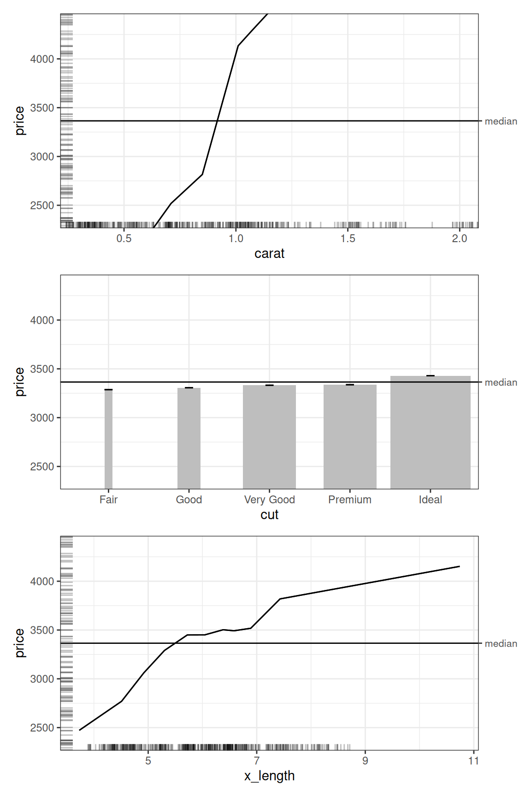

This makes the differences between cut qualities easier to see. Parts of
the `carat` and `x_length` curves extend beyond the viewing window. In
the column chart, the visible columns also begin above their original
zero baseline; we should read the axis values when assessing their
differences.

Notice that the `carat` plot retains the x limits set in the preceding
section. Leaving an axis at its default `NULL` preserves that axis’s
existing limits; it does not reset the zoom. The other two 1D plots
retain their original x ranges, and the 2D plots retain their original
limits.

We can also set both axes in one call:

``` r

both_zoomed_plots <- diamonds_plots |>
  customize(
    x_cols = "carat",
    zoom_x = carat_limits,
    zoom_y = price_limits
  )

both_zoomed_plots |>
  subset(list(d1 = TRUE)) |>
  print(ncol = 1)
```

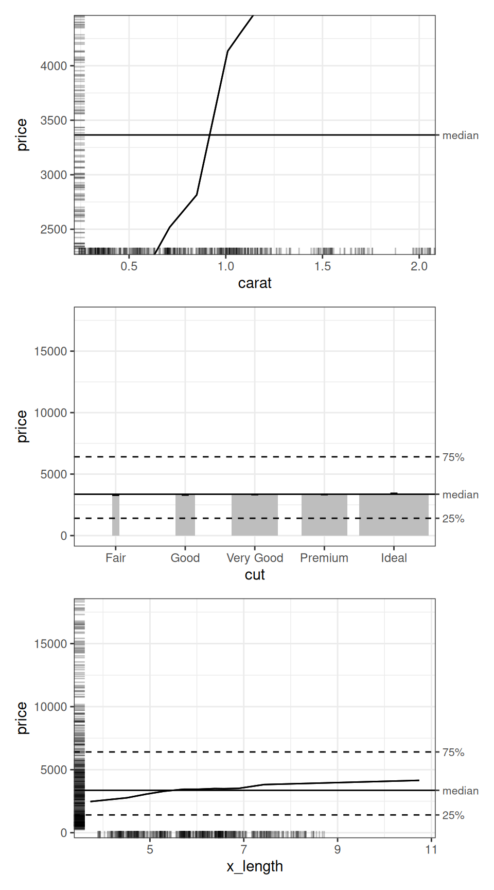

To zoom out again, supply wider limits. To recover the original view,
start from `diamonds_plots`, which we have kept unchanged.

## 6 Flexible customizations with `layers`

ALE plots in the `ale` package are implemented with {ggplot2}, so they
retain its full flexibility in customization. This flexibility is
leveraged through the `layers` argument of
[`customize()`](https://tripartio.github.io/ale/reference/customize.md),
which accepts a list of additions that
[ggplot2](https://ggplot2.tidyverse.org) supports through its `+`
operator. This includes themes, geometries, and scales. The additions
are applied to each selected plot in the order given in the list.

The additions must be appropriate for every selected plot. Shared themes
can be applied across dimensions, while scales, coordinates, and
geometries may depend on each plot’s axes, mappings, or data. In
particular, the y-axis represents the outcome in 1D plots and the second
predictor in 2D plots.

### 6.1 Apply a common theme to all plots

We begin again with the original plots. We can select both dimensions
explicitly to apply the same appearance settings to all six plots:

``` r

common_theme <- list(
  theme_minimal(base_size = 12),
  theme(
    axis.text = element_text(size = 10),
    axis.text.x = element_text(angle = 45, hjust = 1),
    axis.text.y = element_text(face = 'bold'),
  )
)

themed_plots <- diamonds_plots |>
  customize(
    x_cols = list(d1 = TRUE, d2 = TRUE),
    layers = common_theme
  )

themed_plots |>
  subset(list(d1 = TRUE)) |>
  print(ncol = 1)
```

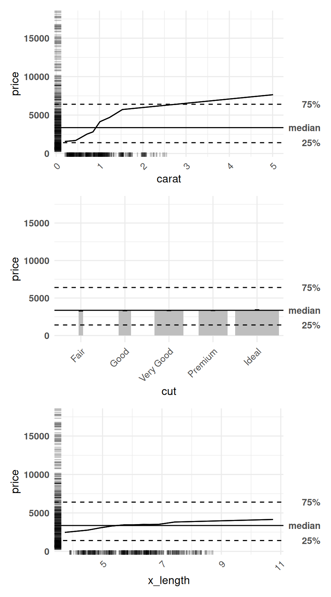

The 2D plots have also received these settings; we will display them
after changing their colours below. Keeping the theme settings in a list
lets us reuse them in other calls.

### 6.2 Mark one carat in the 1D carat plot

We add a vertical reference line at one carat. Selecting `"carat"`
applies it only to that 1D plot, leaving interactions involving `carat`
unchanged.

``` r

carat_reference <- list(
  geom_vline(
    xintercept = 1,
    colour = "red",
    linetype = "dotted",
    linewidth = 1.5
  )
)

reference_plots <- themed_plots |>
  customize(
    x_cols = "carat",
    layers = carat_reference
  )

get(reference_plots, "carat")
```

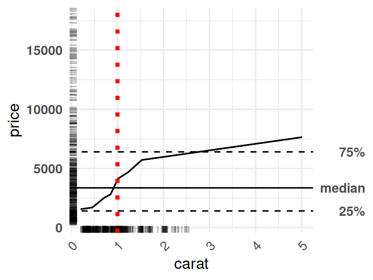

### 6.3 Use the default ggplot colours for cut

By default, the 1D `cut` plot draws grey columns. We can set the colours
to the {ggplot2} default of using different colours per category simply
by adding a
[`ggplot2::scale_fill_discrete()`](https://ggplot2.tidyverse.org/reference/scale_colour_discrete.html)
layer:

``` r

cut_colours <- list(scale_fill_discrete())

cut_colour_plots <- diamonds_plots |>
  customize(
    x_cols = "cut",
    layers = cut_colours
  )

get(cut_colour_plots, "cut")
```

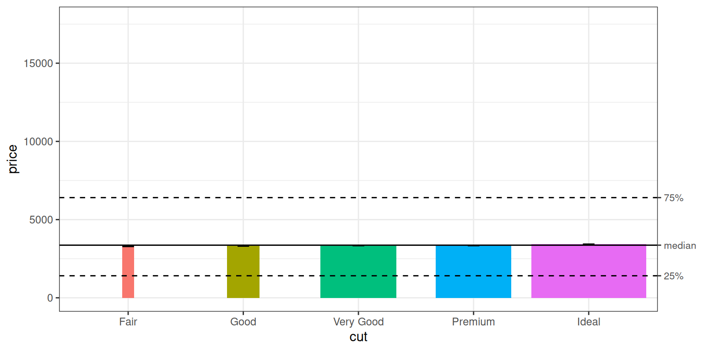

The colours come from the default discrete fill palette of the active
ggplot theme. We use
[`scale_fill_discrete()`](https://ggplot2.tidyverse.org/reference/scale_colour_discrete.html)
explicitly because `cut` is ordered, for which ggplot would otherwise
select an ordered palette. Each quality is already identified on the
x-axis, so the new columns do not add a fill legend.

### 6.4 Change the colours of all 2D plots

We can replace the red-grey-blue fill scale with a blue-ivory-green
scale for all three interaction plots in one call. We keep the midpoint
at the median diamond price, matching the default centring of these
plots.

``` r

interaction_colours <- list(
  scale_fill_gradient2(
    low = "lightskyblue",
    mid = "ivory",
    high = "darkgreen",
    midpoint = median(diamonds$price)
  )
)
  
interaction_colour_plots <- diamonds_plots |>
  customize(
    x_cols = list(d2 = TRUE),
    layers = interaction_colours
  )

interaction_colour_plots |>
  subset(list(d2 = TRUE)) |>
  print(ncol = 1)
```

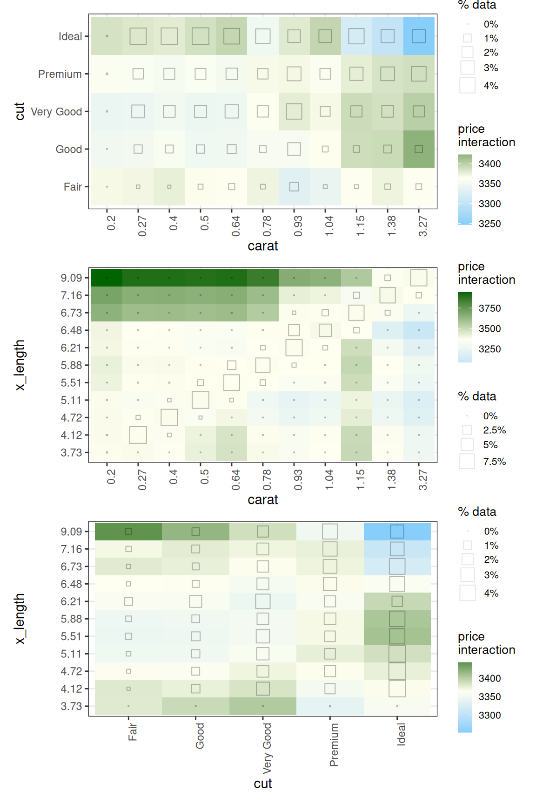

Only the 2D fill scales change; the 1D `cut` plot retains its discrete
colours. The size legends and hollow squares continue to show how much
data supports each interaction bin.

When `layers` and zoom arguments occur in the same call,
[`customize()`](https://tripartio.github.io/ale/reference/customize.md)
adds the layers first, then applies the requested zoom. A `NULL` zoom
argument preserves the corresponding limits after the layers have been
added. If you need to control the ordering of coordinate changes
yourself, supply them only through `layers`.

## 7 Combine the customizations

We can now combine the settings in a pipeline. Starting from the
original collection, we apply the common theme to all six plots, zoom
the y-axis for all three 1D plots, add the one-carat line and x zoom
only to `carat`, recolour `cut`, and change the fill scale of all the
interactions.

``` r

final_plots <- diamonds_plots |>
  customize(
    x_cols = list(d1 = TRUE, d2 = TRUE),
    layers = common_theme
  ) |>
  customize(
    x_cols = list(d1 = TRUE),
    zoom_y = price_limits
  ) |>
  customize(
    x_cols = "carat",
    layers = carat_reference,
    zoom_x = carat_limits
  ) |>
  customize(
    x_cols = "cut",
    layers = cut_colours
  ) |>
  customize(
    x_cols = list(d2 = TRUE),
    layers = interaction_colours
  )

final_plots |>
  subset(list(d1 = TRUE)) |>
  print(ncol = 1)
```

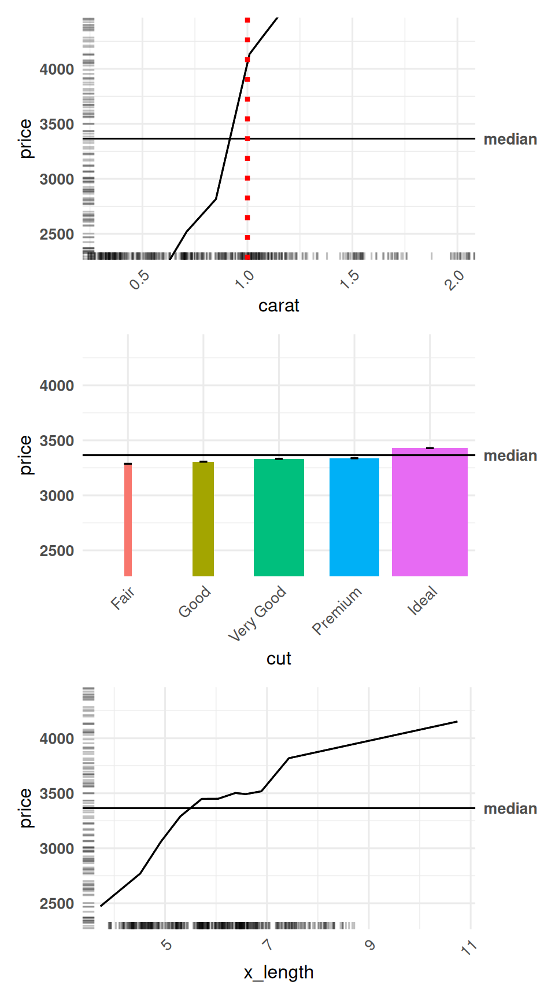

``` r

final_plots |>
  subset(list(d2 = TRUE)) |>
  print(ncol = 1)
```

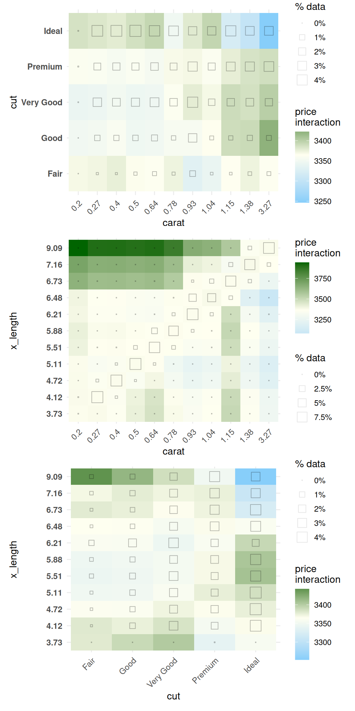

The main arguments demonstrated in this article are:

| Argument | Purpose |
|----|----|
| `x_cols` | Select the variables or interactions whose plots should change. |
| `exclude_cols` | Exclude plots from that selection. |
| `zoom_x` | Set the visible x range of the selected plots. |
| `zoom_y` | Set the visible y range of the selected plots. |
| `layers` | Append ggplot additions to each selected plot. |

See
[`help(customize)`](https://tripartio.github.io/ale/reference/customize.md)
for the full function reference and
[`help(ALEPlots)`](https://tripartio.github.io/ale/reference/ALEPlots.md)
for options available when first generating plots.
